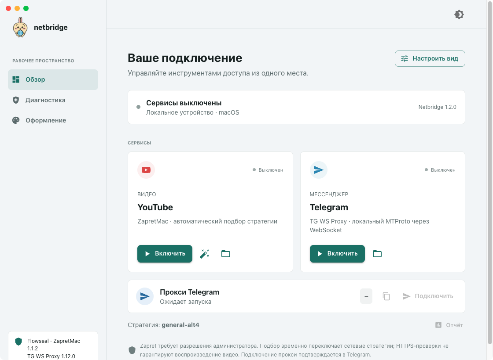
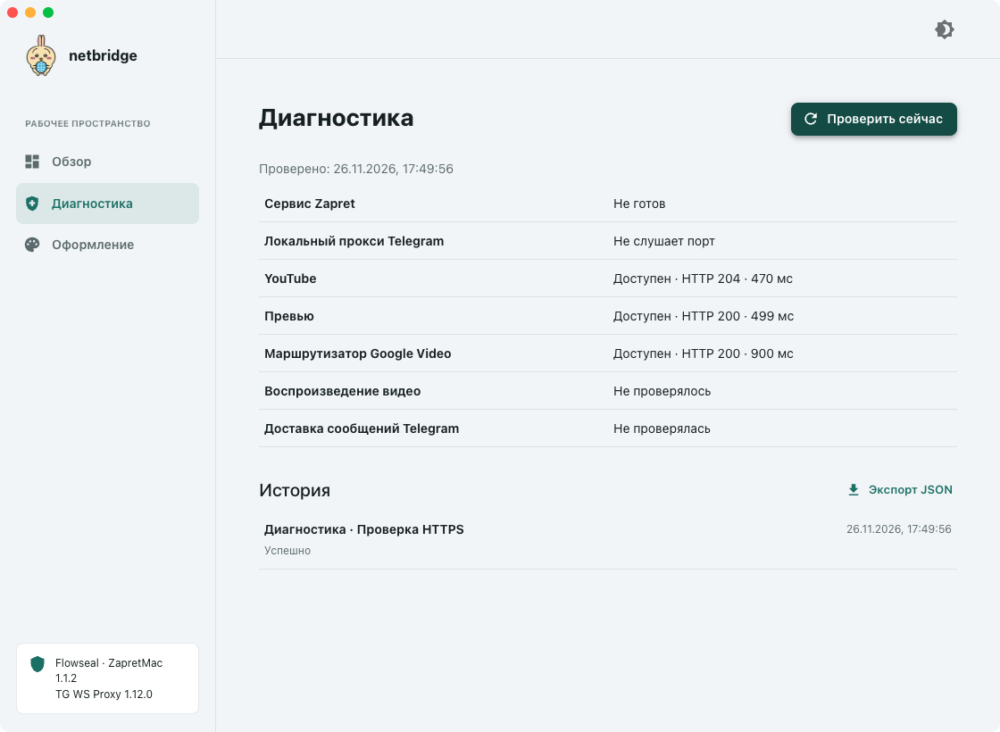

# Netbridge для macOS

Netbridge объединяет ZapretMac для YouTube и локальный TG WS Proxy для Telegram
в одном приложении. Сервисы можно включать и выключать из окна или строки меню
macOS. Это независимый проект, не официальный релиз Flowseal.

### Скачать и запустить

1. Откройте [релиз 1.2.0](https://github.com/nukiwastaken/antizapret-materialui/releases/tag/v1.2.0)
   и скачайте DMG для своего Mac: `arm64` для Apple Silicon, `x64` для Intel. Требуется macOS 14 или новее. Вместо DMG можно скачать ZIP.
2. Перенесите Netbridge в «Программы» и откройте. Сборки не нотарифицированы Apple.
3. Нажмите «Включить» на карточке нужного сервиса. При первом запуске Netbridge
   загрузит и проверит компоненты. Для Zapret macOS запросит пароль администратора;
   для Telegram нажмите «Подключить» и подтвердите прокси в мессенджере.

### Что есть в приложении

- **Обзор:** состояние обоих сервисов, управление ими и отчёт автоподбора Zapret.
- **Диагностика:** HTTPS-проверки без перезапуска, история событий и экспорт JSON
  без ключей, ссылок и локальных путей. Тесты не подтверждают воспроизведение видео
  или доставку сообщений. После сна или смены маршрута результат помечается устаревшим.
- **Строка меню:** значок Netbridge, быстрые команды и диагностика при закрытом окне.
- **Офлайн-импорт:** кнопка с папкой принимает официальные архивы закреплённых версий,
  проверяя SHA-256 и подпись. Импорт не запускает сервис.





<details>
<summary>Техническая документация и сборка (English)</summary>

The supplied Netbridge artwork is used as a transparent sidebar logo and the macOS
application icon. The logo's hover animation respects Reduce Motion. To recreate
the assets from the original white-background image on macOS, install Pillow and
run `python3 scripts/prepare-logo.py /absolute/path/to/source.jpeg`.

## First Launch

1. Open Netbridge and click **Enable** for YouTube or Telegram.
2. Netbridge downloads the pinned official universal build, checks its SHA-256,
   bundle identity and code signature, then installs it into its private data directory.
   No manual archive download or separate upstream installation is required.
3. YouTube asks for macOS administrator approval to install/manage the upstream
   system service and PF rules. Keep the original ZapretMac app closed while using
   Netbridge. First-time strategy selection can take several minutes.
4. Telegram generates a private localhost config. Click **Connect** to open the
   proxy link and confirm the connection in Telegram. Failure to open Telegram
   does not stop the local proxy. Its tray app may show upstream first-run
   notices. The dashboard checks the listener's process identity, not Telegram delivery.

Internet access to GitHub and release asset hosts is required for the first download.
If these are blocked, use the folder icon on the stopped service to import the
exact ZIP or DMG from the pinned releases below. Import performs the same checks
as download and does not start the service. Verified installed components are reused.
Stopping Zapret uses its installed system script and does not download components.
macOS Gatekeeper/authorization dialogs
are not disabled or bypassed. Ad-hoc signatures are integrity checks, not Apple
notarization or proof of publisher identity; pinned archive hashes are checked too.

## YouTube Autoconfiguration

The pinned ZapretMac engine requires an IPv4 default route through a non-tunnel
interface with a gateway and its ARP MAC address. It does not work with the current
full-tunnel VPN route. Turn off VPN/tunnel mode in the other application before
starting YouTube autoconfiguration. Netbridge checks for incompatible default
routes before downloads, configuration writes or administrator authorization,
and checks again after authorization before changing the service.
It does not disable VPNs or reroute traffic around them automatically.
IPv6-only connectivity is not supported by this engine integration.

Before installation, Netbridge adapts a private staging copy of each pinned strategy:
the first QUIC profile also includes `list-google.txt`, matching the existing
Google/YouTube TCP profile. Upstream's initial QUIC hostlist otherwise omits these
domains, and the later IPSet-only UDP profile does not cover them in `none` mode.
Exclusions, desync settings and TCP profiles are preserved; the signed component
bundle and user lists are not edited. The cache key includes the adaptation revision
to prevent reusing results from the old rules.

On first enable, Netbridge iterates the strategies shipped by ZapretMac. For each,
it restarts the engine, waits for a new process/interface/PF route, and performs two
rounds of HTTPS requests to YouTube (`generate_204`), a thumbnail and Google's video
redirector. Probes run as the current user because upstream PF excludes root traffic.

Candidates must pass both YouTube checks and at least four of six checks overall.
Ranking favors successful checks, then aggregate request time. The winner is applied
and checked again. These are reachability checks, **not playback or throughput tests**;
the Google Video `report_mapping` response is not a media download. Browser QUIC,
real CDN streams, IPv6 and provider-specific behavior may differ. Configuring the
QUIC hostlist is not proof that QUIC playback succeeds.

The successful profile is cached by default gateway, interface and pinned Zapret
version. Active point-to-point routes without a gateway are accepted but skip
profile caching because the interface alone does not identify a network.
IPv6 default routes are checked if no usable IPv4 default route is found.
This is a network hint, not a unique provider identifier. On subsequent
enable the profile is rechecked; failure triggers a new search within the same
authorization operation. The wand button forces a new search.

Cancel, failed checks and handled errors restore the previous strategy/IPSet mode
and the service's previous running/stopped state. System installation files may
remain. No passing strategy produces an error, never a fabricated success.
Operations are serialized by a root-owned lock. A 30-minute deadline is checked
between phases and while waiting for probes/service readiness; it is not a hard
timeout for upstream installation/restart scripts. No background watchdog delays
completion. Cancel interrupts owned network probes, then waits for rollback before
unlocking the UI; restoring an already running service can take longer.
Power loss/SIGKILL cannot be rolled back automatically; reboot clears a stale lock,
then disable/re-enable Zapret. Do not run upstream strategy tests concurrently.

## Local Data And Services

- App data: `~/Library/Application Support/netbridge-mac/` (Electron `userData`,
  unless overridden at launch).
- Verified components: `components/<service>/<version>/`.
- Telegram config, secret and upstream logs:
  `telegram-home/Library/Application Support/TgWsProxy/`. Its HOME is isolated from
  a separately installed TG WS Proxy. Logs can contain the secret; do not share them.
- Zapret user lists/selection: `~/Library/Application Support/ZapretMac/`.
  Existing list files and IPSet mode are preserved; this directory is shared with upstream.
- Zapret system files: `/Library/Application Support/ZapretMac/`; LaunchDaemon:
  `/Library/LaunchDaemons/io.github.flowseal.zapretmac.plist`.
- Network profiles: `profiles.json` in app data. Theme settings: renderer local storage.
- The last strategy attempt and last successful report are stored separately in
  `strategy-report.json`; the latest 100 app events are stored in `history.json`.

Zapret uses Flowseal's system-wide service and PF configuration, not a per-browser
proxy or an anonymity VPN. It can affect other traffic matched by upstream lists.
Closing Netbridge does not stop services. Disable them using their buttons before
exiting when they should not remain active; deleting Netbridge alone does not
uninstall the upstream system service. Disable Telegram's proxy in Telegram when
you stop its local service.

## Diagnostics

The menu bar item controls both services even when the main window is closed.
**Check now**, in the menu bar or the Diagnostics page, runs three HTTPS checks
as the current user without restarting a service or asking for administrator access.
The page distinguishes service status, HTTPS reachability, video playback and
message delivery. Only the first two are checked. Sleep/wake, a detected change
to the default route, or a service change marks the result stale without taking action.
The JSON history export contains timestamps, service names, actions and outcomes;
it excludes raw logs, local paths, connection links, keys and network identifiers.

## Pinned Components

Official archives are downloaded unchanged, not bundled into Netbridge installers.
New upstream versions require a reviewed app update; no unreviewed payload is elevated.

| Component | Repository | Version | Asset |
| --- | --- | --- | --- |
| ZapretMac | [Flowseal/zapret-mac-discord-youtube](https://github.com/Flowseal/zapret-mac-discord-youtube) | 1.1.2 | ZapretMac-macOS-universal.zip |
| TG WS Proxy | [Flowseal/tg-ws-proxy](https://github.com/Flowseal/tg-ws-proxy) | v1.12.0 | TgWsProxy_macos_universal.dmg |

Hashes are in `electron/components.cjs`. Upstream licenses and notices remain in
downloaded bundles. Refer to each repository's license for its own code and dependencies.

## Development

Uses Node.js 24.13.1 and npm (pinned in `.nvmrc` and used in macOS CI).

```sh
nvm use
npm ci
npm test
npm run dev
npm run dist:mac -- --arm64
```

`npm test` includes an isolated simulation of the privileged runner: no root,
PF/route changes, live strategies or real network probes are used in those tests.
Building supports `--arm64` or `--x64`; downloaded Flowseal components are universal.
Local packages are unsigned/not notarized. Developer ID distribution requires
the owner's Apple Developer credentials. Successful build/unit tests alone do not
establish that a strategy works on a particular censored network.

</details>
