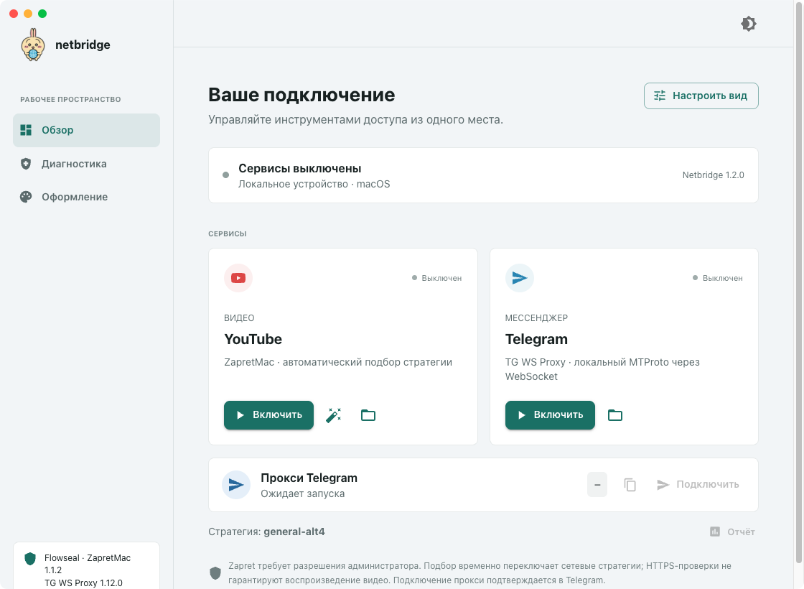
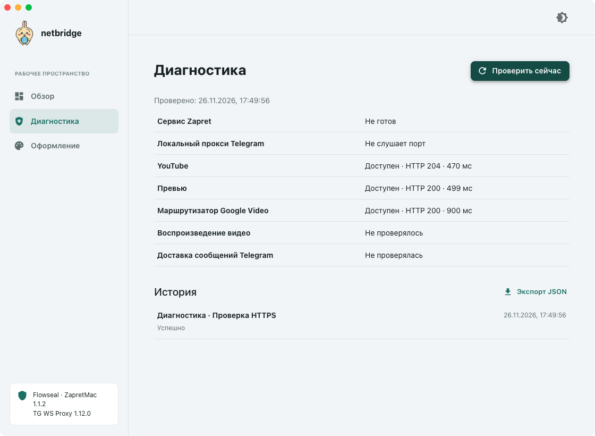

Netbridge управляет ZapretMac для YouTube и локальным прокси TG WS Proxy для Telegram из одного окна и строки меню macOS.

### Что нового

- «Диагностика» проверяет доступность HTTPS без перезапуска сервисов и запроса администратора. После сна или смены маршрута результат помечается устаревшим. Проверка не подтверждает воспроизведение видео или доставку сообщений.
- История последних 100 событий с экспортом JSON без ключей, ссылок и локальных путей.
- Цветной логотип Netbridge в строке меню: управление обоими сервисами и диагностика даже при закрытом окне.
- Офлайн-импорт официальных ZIP/DMG с проверкой SHA-256 и подписи.
- Остановка Zapret без повторной загрузки компонента. Netbridge ждёт, пока macOS подтвердит остановку, вместо преждевременной ошибки.
- Исправлена отмена автоподбора. Последний успешный отчёт и последняя попытка сохраняются отдельно. Запуск Telegram-прокси больше не зависит от открытия мессенджера.

### Установка

Требуется macOS 14 или новее. Выберите `arm64` для Apple Silicon или `x64` для Intel. Откройте DMG и перенесите Netbridge в «Программы» либо распакуйте ZIP. Сборки не нотарифицированы Apple. Контрольные суммы опубликованы в `SHA256SUMS-1.2.0.txt`.

### Скриншоты

